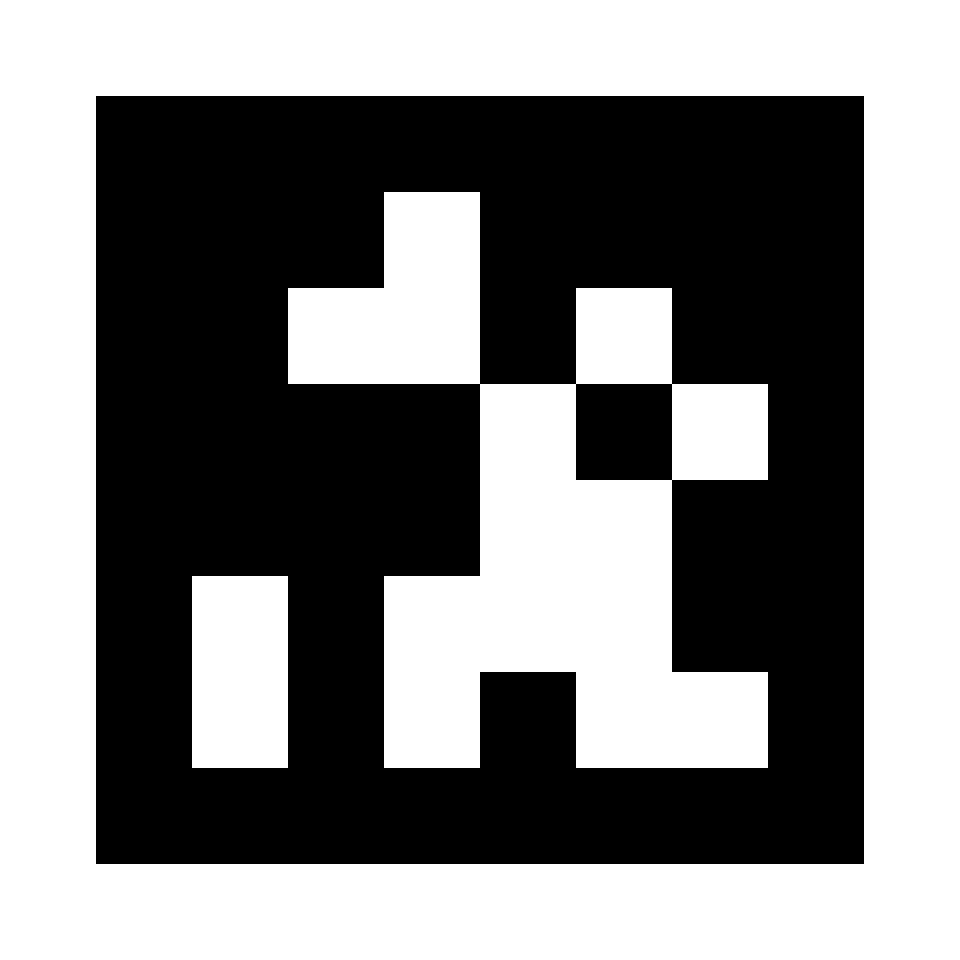
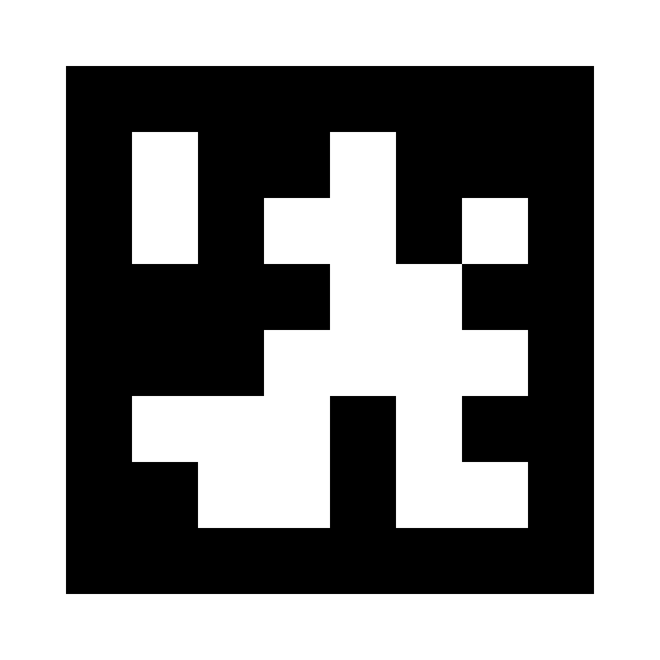

# 사람이 설치하는 MechDog 순찰 코스

처음에는 두 지점만 사용합니다. A에서 출발하고, B에서 한 번 멈춘 뒤 A로 돌아오면 한 바퀴가 끝납니다. 대시보드에 넣을 **방문 순서는 `1,0`**입니다. 아래 치수 중 태그와 확인선은 인쇄 규격이고, 테이프 폭은 설치를 시작할 때 쓸 제안값입니다. 실제 카메라 화면을 보며 조정하세요.

## 1. A와 B를 한 장씩 출력하기

1. [A4 인쇄 PDF](patrol-print/apriltag-stations-a4.pdf)를 내려받아 엽니다. 1쪽은 **A · ID 0**, 2쪽은 **B · ID 1**입니다. 대시보드를 실행하기 전에도 인쇄할 수 있습니다.
2. 흰 A4 용지(210 × 297 mm)에 **세로, 단면, 한 면에 한 쪽, 실제 크기 100%**로 출력합니다. 흑백 인쇄로 충분합니다. 인쇄 창에서 ‘용지에 맞춤’과 ‘축소’를 끕니다.
3. 종이 아래 확인선의 양 끝을 자로 잽니다. **50 mm**여야 합니다. 태그의 검은 정사각형은 바깥쪽 한 변이 **140 mm**입니다. 치수가 다르면 인쇄 배율을 확인합니다.
4. 흰 여백을 그대로 두고 종이를 평평한 판이나 벽에 붙입니다. 테이프는 종이 바깥 가장자리에 붙입니다. 빛을 반사하는 비닐은 피합니다.

| A · 출발 및 복귀 | B · 첫 방문 |
| --- | --- |
|  |  |

위 PNG는 표지판에 넣거나 개별 저장할 때 사용합니다. 코너에 지점을 추가할 때는 자율주행 탭의 방문 순서에 ID를 추가하면 해당 태그의 인쇄 링크가 생깁니다.

## 2. 주행 전에 카메라 화면 열기

1. [README의 Wi-Fi 연결 절차](../README.md#인터넷을-유지하는-wi-fi-연결)에 따라 카메라와 노트북을 같은 핫스팟에 연결합니다. 아래 명령은 로봇 A 기준입니다. 로봇 B를 쓰면 `--robot B`로 바꿉니다. 로봇 ID와 종이의 지점 A/B는 별개입니다.
2. 저장소 폴더에서 아래 명령을 실행합니다.

   ```powershell
   python -m pip install "opencv-python-headless>=4.8"
   python -m dashboard.server --robot A --hotspot --sensors-only
   ```

3. 브라우저에서 `http://127.0.0.1:8090` → **자율주행**을 엽니다. 태그 한 장을 카메라 정면에 두고 화면에 윤곽과 올바른 ID가 뜨는지 A, B 각각 확인합니다. 태그 위치는 사람이 보는 높이보다 **서 있는 로봇의 카메라가 보는 높이**를 기준으로 잡습니다.

## 3. 코스 한 가지 선택하기

### 선 기반 코스

| 준비물 | 설치 방법 | 미리보기에서 확인할 것 |
| --- | --- | --- |
| 검은색 무광 테이프 | 밝은 단색 바닥에 폭 2~3 cm부터 시작해 완만한 타원 한 바퀴를 만듭니다. | 직선과 곡선에서 화면 아래쪽의 노란 점이 검은 선 위에 놓입니다. |
| 선명한 파란색 무광 테이프 | A와 B에 진행선과 직각으로 가로 띠를 붙입니다. 폭은 2~3 cm부터 시작하고 양옆으로 길게 뻗게 합니다. | 정지 위치에서 영상 아래 ⅓ 영역에 띠 윤곽이 표시됩니다. 가로 길이는 화면 너비의 약 절반 이상이 되게 조절합니다. |
| A/B 태그 표지 | 각 띠에 접근하는 방향으로 표지를 세웁니다. 로봇이 띠를 볼 때 예상 태그 하나가 정면에 들어오게 합니다. | B 띠에서는 ID 1만, A 띠에서는 ID 0만 보입니다. 띠를 지난 위치에서도 검은 선이 다시 보입니다. |

본체를 움직이지 않고 먼저 직선·곡선·두 정지 위치에 각각 놓아 화면을 확인합니다. 카메라를 너무 숙여 태그가 잘리면 표지 높이와 각도를 함께 조절합니다. 출발할 때는 로봇을 **A의 띠를 막 지난 곳**에 놓고 검은 선을 따라 B 쪽을 보게 합니다.

### 선 없는 코스

1. 바닥에는 테이프를 붙일 필요가 없습니다. 출발점에서 B가 보이고, B에 도착한 뒤 설정한 방향으로 회전하면 A를 찾을 수 있게 표지의 방향을 잡습니다. 처음에는 두 지점 사이를 비워 둡니다.
2. 탭에서 **선 없음 · 태그 접근**을 선택합니다. 로봇을 B에서 멈추길 원하는 위치에 직접 놓고, 화면 중앙에 ID 1 하나가 보이면 **화면 속 태그의 도착 기준 저장**을 누릅니다. A에서도 ID 0으로 반복합니다. 화면의 저장 목록에 **0, 1**이 있는지 확인합니다.
3. 표지판·벽이 전방 초음파에 잡힐 수 있습니다. 원하는 정지 위치를 잡을 때 **조종 탭에서 유효한 초음파 값이 30 cm를 넘고 여유가 있는지** 실물 연결 후 확인하세요. 순찰은 30 cm 이하이거나 거리를 읽지 못하면 멈춥니다.
4. 기준은 해당 노트북에 로봇 ID별로 저장됩니다. 출력 크기나 카메라 설치 각도를 바꾸면 두 위치에서 다시 저장합니다. 코스 전체에서 선택한 한 방향으로 다음 태그를 찾을 수 있게 배치합니다. 탐색 제한은 5초입니다.

## 4. 첫 바퀴 실행과 결과 확인

1. 미리보기 서버를 실행한 터미널에서 Ctrl+C를 누릅니다. 본체와 카메라를 연결하고 `python -m dashboard.server --robot A --hotspot --allow-real`로 다시 실행합니다.
2. 대시보드를 새로고침합니다. **조종**에서 본체 연결·배터리·초음파를 확인하고 주변을 비운 뒤 **잠금 해제**를 누릅니다. **자율주행**에서 설치한 모드와 방문 순서 `1,0`을 선택합니다.
3. **한 바퀴 시작**을 누르고 탭을 화면에 유지합니다. B에서 정지 후 방문 **1**, A에서 정지 후 방문 **1 → 0**과 **한 바퀴 완료**가 표시되는지 봅니다. 운영자가 멈추려면 **정지**, 즉시 개입해야 하면 상단 **비상 정지(Esc)**를 누릅니다.
4. 각 지점에서 원한 위치와 실제 멈춘 위치 사이를 cm로 재고, 완주 여부·수동 개입 횟수·정지 사유를 적습니다. 중단 후 다시 시작하면 입력한 방문 순서의 처음부터 진행합니다.

| 현장에서 보이는 증상 | 사람이 확인할 것 |
| --- | --- |
| 노란 점이 없거나 엉뚱한 곳에 표시됨 | 선을 화면 아래 ⅓에 넣습니다. 바닥 무늬나 그림자를 피하고 검은색 테이프의 폭과 조명을 조절합니다. |
| 파란 띠를 알아보지 못함 | 띠가 밝고 선명한 파랑인지, 영상 아래쪽에서 충분히 길고 가로로 보이는지 확인합니다. |
| 예상 ID 오류 또는 태그 윤곽이 없음 | 정지 위치에서 종이 전체와 흰 여백이 보이게 하고, 다른 태그는 시야 밖으로 옮깁니다. 역광과 반사를 줄입니다. |
| 시작 버튼이 비활성 또는 주행이 중단됨 | 탭의 정지 사유, 실주행 실행 옵션, 본체 잠금, 영상·초음파 수신 상태를 확인합니다. 선 없는 모드는 방문 순서의 모든 ID에 도착 기준을 저장해야 합니다. |

실물 완주와 정지 오차는 현장에서 확인할 항목입니다. 두 모드에서 정상 완주를 확인한 뒤, 선이나 목표가 가려졌을 때와 탭을 떠났을 때의 정지도 각각 기록하세요.
